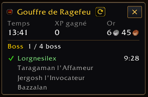
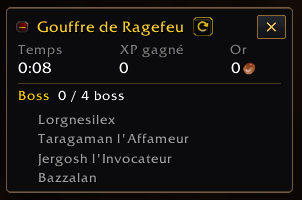
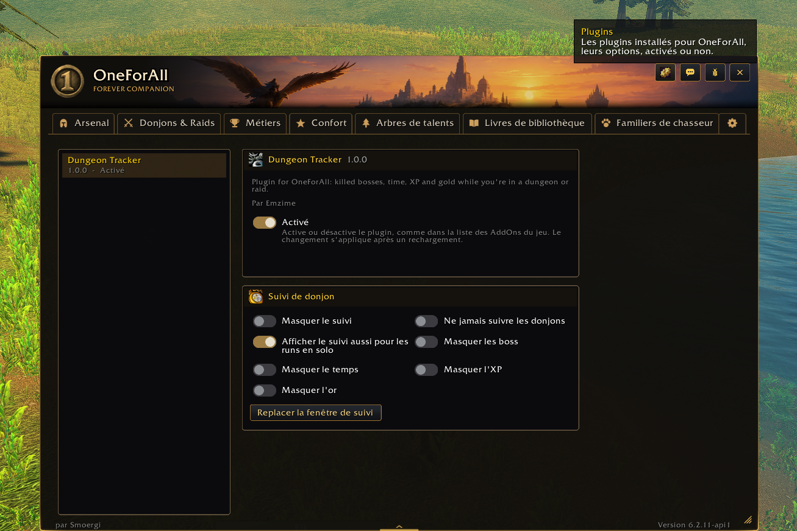

# OneForAll – Dungeon Tracker

A **plugin for [OneForAll](https://discord.gg/JSPUqw4g)**, the all-in-one WoW Forever companion by Smoergi: a small window that opens when you enter a dungeon or raid, shows the killed bosses, the time, the XP and the gold, and closes when you leave.

> **Needs OneForAll with the plugin API:** [OneForAll – Plugin API](https://github.com/Emzime/OneForAll-API). It doesn't work with an OneForAll without the API. Screenshots were taken in game with a French client.

| Folder | What it is | Version |
|---|---|---|
| `OneForAll_DungeonTracker/` | The Dungeon Tracker plugin | `1.0.1` |

## Documentation

| Page | For |
|---|---|
| [User guide](docs/user-guide.md) | Players: install, the window, runs, options, commands, what to send when a boss isn't ticked. |
| [How it works](docs/how-it-works.md) | Contributors and plugin authors: how the plugin uses the OneForAll API, kill detection, runs, saved data, the log. |

<table align="center"><tr>
<td align="center"> First boss down at 9:28</td>
<td align="center"> After the reset button (next to the name): back to zero</td>
</tr></table>

## What the window shows

- **Time | XP earned | Gold**
  - **Time:** time spent inside the instance. It turns green when the run is done.
  - **XP earned:** XP your character gained inside, minus quest turn-ins. A level-up is counted correctly.
  - **Gold:** money your character gained inside. Only gains count: buying or repairing doesn't lower it.
  - At the level cap, the XP column is replaced by gold, as in Dungeon Journal.
  - Only your own character is counted, never the whole group.
- **Bosses:**
  - The dungeon's bosses, in the order of OneForAll's own data and in the chosen language.
  - Each killed boss gets a green tick and the time it died.
  - A counter shows progress (e.g. *1 / 4 bosses*).
  - Rare and summoned bosses are optional: they are listed once killed but don't block completion.
- **Completion:** the clock stops when every required boss is down. The chat then shows *"Ragefire Chasm completed in 23:41."*

## Same run or new run

- The run continues if you come back within 30 minutes (corpse run, repairs) and survives `/reload`.
- It starts again from zero after an instance reset. The reset is detected:
  - from the game's own reset message;
  - when a boss already ticked is seen alive at full health (for when another group member reset it).
- When neither catches it, the **reset button** next to the dungeon's name starts the run again (with a confirmation), as in Dungeon Journal.

## Handling

- drag to move;
- click the title to fold the boss list;
- reset button (or right-click on the title) to restart;
- click a boss to open it in OneForAll's Dungeons tab;
- the X hides the window for this run.

Commands: `/ofa run` shows or hides the window, `/ofa run reset` restarts the run, `/ofa run debug` shows the tracker's log in the chat.

Bosses are matched by NPC ID and by encounter ID, so kills count whatever the client's language. Encounter IDs and the client's boss names are learned on the first kill and kept per account. The last 300 log lines are saved in `WTF/Account/<account>/SavedVariables/OneForAll_DungeonTracker.lua`.

## How kills are detected

WoW Forever doesn't let addons read the combat log, so kills come from:
- `ENCOUNTER_END` / `BOSS_KILL` when the client sends them;
- a dead boss seen as a unit: target, focus, mouseover, boss frames, nameplates, or the group's targets;
- a corpse you loot.

Bosses are matched by NPC ID, then by encounter ID, then by name and aliases. Values the client marks as secret are skipped.

## Options

The plugin's options are on OneForAll's **Plugins** page (gears button in the title bar), with the same options as the Dungeon Journal tracker. They are saved in OneForAll's profile.

The Dungeon Tracker on OneForAll's Plugins page (French client).

| Option | Effect |
|---|---|
| Hide Tracker | Hides the tracker for this run. Its X ticks this, and a new run unticks it. |
| Never track dungeons | The window never opens by itself. Runs are still recorded, and `/ofa run` still opens it. |
| Show Tracker for solo runs too | Opens the window without a group too (**on** by default). |
| Hide Bosses | No boss list. |
| Hide Time | No time column. |
| Hide XP | No XP column. |
| Hide Gold | No gold column. |
| Reset tracker position | Puts the window back in its default place. |

## Files and saved data

| File | What it is |
|---|---|
| `OneForAll_DungeonTracker.toc` | `## Dependencies: OneForAll`, version `1.0.1`. |
| `Locales.lua` | The plugin's texts in Deutsch, Français, Español, Português (Brasil); English is the default. |
| `DungeonTracker.lua` | The tracker: window, kill detection, XP and gold, reset detection, options and their part of the Plugins page, `/ofa run`. |

Saved data:
- `OneForAllDungeonTrackerCharDB.run`: the current run, per character.
- `OneForAllDungeonTrackerDB` (per account): the encounter IDs and boss names learned in the client's language, and the last 300 log lines. A run from the earlier `-dt` builds is taken over.
- OneForAll's profile (`plugin.OneForAll_DungeonTracker.*`): the options, window position and fold. The options of the earlier `-dt` builds are taken over once.

---

## Install

1. Install **OneForAll with the plugin API** first: [OneForAll – Plugin API](https://github.com/Emzime/OneForAll-API/releases).
2. Download `OneForAll_DungeonTracker-<version>.zip` from the latest **Release** (or from the **Actions** tab, artifacts of the last build).
3. Close the game. Put its `OneForAll_DungeonTracker` folder into your WoW Forever client's `Interface/AddOns` folder, next to `OneForAll`.
4. Start the game. The options are on OneForAll's **Plugins** page (gears button in the title bar) → **Dungeon Tracker**.

## Build

`.github/workflows/build.yml` checks every Lua file and builds `OneForAll_DungeonTracker-<version>.zip`:
- on every push and pull request, as a workflow artifact;
- when a tag starting with `v` is pushed (e.g. `git tag v1.0.1 && git push --tags`), also as a GitHub release.

For a new version, raise `## Version:` in `OneForAll_DungeonTracker/OneForAll_DungeonTracker.toc` and tag it the same way.

## Credits & license

- **Dungeon Tracker** is licensed under **GPL-3.0-or-later** (`OneForAll_DungeonTracker/LICENSE.txt`). It is inspired by the Dungeon Journal tracker (its options and reset button). The code is new and built on OneForAll's own data, read through the plugin API.
- **OneForAll** © Smoergi. Official OneForAll, support and suggestions: **https://discord.gg/JSPUqw4g**
