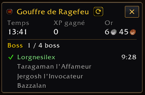
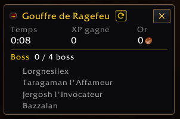
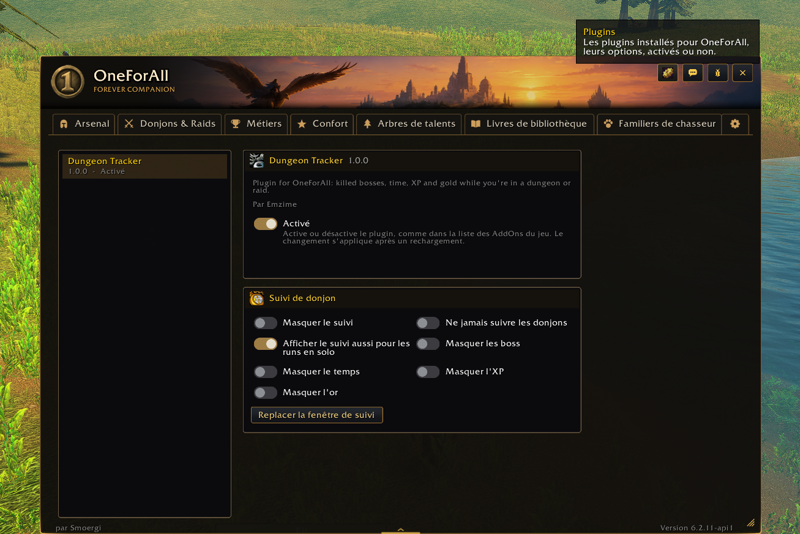

# Dungeon Tracker – user guide

The Dungeon Tracker is a small window that follows your run in a dungeon or raid: killed bosses, time, XP and gold. It is a **plugin for OneForAll**: it needs [OneForAll with the plugin API](https://github.com/Emzime/OneForAll-API).

## Install

1. Install **OneForAll with the plugin API** ([releases](https://github.com/Emzime/OneForAll-API/releases)): its `OneForAll` folder replaces yours in `Interface/AddOns`.
2. Download `OneForAll_DungeonTracker-<version>.zip` from this repository's [releases](https://github.com/Emzime/Plugin-DungeonTracker-OneForAll/releases).
3. Close the game. Put its `OneForAll_DungeonTracker` folder into `Interface/AddOns`, next to `OneForAll`.
4. Start the game. A gears button now appears in OneForAll's title bar: it opens the **Plugins** page, with the Dungeon Tracker's options.

```
Interface/
  AddOns/
    OneForAll/
    OneForAll_DungeonTracker/
```

## The window

<table align="center"><tr>
<td align="center"></td>
<td align="center"></td>
</tr></table>

It opens by itself when you enter a dungeon or raid with a group, and closes when you leave. It also opens solo, unless you turn **Show Tracker for solo runs too** off.

- **Title:** the dungeon's name, with a counter of killed bosses (*1 / 4 bosses*).
- **Time:** the time spent inside. It turns green when the run is done.
- **XP earned:** the XP your character gained inside, without quest turn-ins. At the level cap, this column isn't shown.
- **Gold:** the money your character gained inside (loot, sales…). Spending doesn't lower it.
- **Bosses:** the dungeon's bosses in order. Each killed boss gets a green tick and the time it died. Rare and summoned bosses are listed once killed, and are never required.

Only **your character** is counted, never the whole group.

When every required boss is down, the clock stops and the chat shows, e.g., *"Ragefire Chasm completed in 23:41."*

### Mouse and buttons

| Action | Effect |
|---|---|
| Drag the window | Moves it. |
| Click the title | Folds or unfolds the boss list. |
| Reset button (next to the name), or right-click the title | Starts the run again from zero, after confirming. |
| Click a boss | Opens it in OneForAll's Dungeons tab. |
| X | Hides the window for this run (see *Hide Tracker* below). |

## Same run, new run

- **Coming back within 30 minutes** (corpse run, repairs, a break) continues the same run. A `/reload` or a disconnection doesn't lose it either.
- **A new run** starts by itself:
  - when the instance is reset (the game's reset message);
  - when a boss already ticked is seen alive at full health again (another group member reset the instance);
  - when you come back after more than 30 minutes, or enter after a finished run.
- **When neither catches it**, use the reset button next to the name.

## Options

On OneForAll's **Plugins** page (gears button in the title bar) → **Dungeon Tracker**. They are saved in OneForAll's profile for the character.

<p align="center"></p>

| Option | Effect |
|---|---|
| Hide Tracker | Hides the window for this run. The X ticks it, and the next run unticks it by itself. |
| Never track dungeons | The window never opens by itself. Runs are still recorded, and `/ofa run` opens it. |
| Show Tracker for solo runs too | Opens the window without a group too (on by default). |
| Hide Bosses | No boss list. |
| Hide Time | No time column. |
| Hide XP | No XP column. |
| Hide Gold | No gold column. |
| Reset tracker position | Puts the window back in its default place. |

## Commands

| Command | Effect |
|---|---|
| `/ofa run` | Shows or hides the window (in a dungeon). |
| `/ofa run reset` | Starts the run again from zero, after confirming. |
| `/ofa run debug` | Shows the tracker's log in the chat. Type it again to hide it. |

## Bosses in your language

The game names bosses in the client's language, and OneForAll's data is in English. The tracker recognizes bosses by their **NPC ID** and by the **ID of the boss fight**, which are the same in every language.

The first time a boss dies, the tracker learns the fight's ID and the boss's name in your language. They are kept for the whole account: from then on, that boss is ticked at once and shown with its name in your language.

## A boss isn't ticked

Send the tracker's log to the plugin's author:

1. Do the run (or the fight) where the boss isn't ticked.
2. Type `/reload`, or log out, so the game writes the file.
3. Send this file:
   ```
   World of Warcraft/<client folder>/WTF/Account/<your account>/SavedVariables/OneForAll_DungeonTracker.lua
   ```
   It holds the last 300 lines of the log, with the start and end of each boss fight, the bosses seen and the kills counted. It contains nothing personal beyond names in the game.

To watch the log while you play, type `/ofa run debug`.

## Questions

**Does it count the group's XP and gold?** No, only your character's.

**Why is a boss added at the bottom of the list?** The game announced a kill the tracker couldn't match to a boss of the dungeon. Once it has learned that boss, the extra line disappears. If it stays, send the log (see above).

**I turned it off and the window still opens.** *Hide Tracker* only hides it for this run. To stop it opening by itself, tick *Never track dungeons*. To remove the plugin, turn it off on the Plugins page (Enabled switch, then Reload).

**Does OneForAll still work without the plugin?** Yes, exactly as before.
